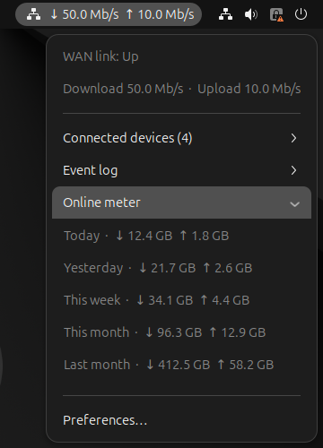

# Router Monitor for GNOME

A GNOME Shell extension that shows what your FRITZ!Box is doing, right in the
top bar: live internet speed, connected devices, the router's event log and the
online meter (data volume per day, week and month). It talks only to the router
on your local network.



*Screenshot with example values.*

## Features

- **Live WAN rates** in the top bar (↓ download, ↑ upload), updated every 5
  seconds, plus link status in the menu.
- **Connected devices**: active devices with IP address and, where the router
  reports it, the device's **link speed** (its connection speed, not its
  traffic). Refreshed every 60 seconds.
- **Event log**: the router's 20 newest events, loaded when you expand the
  submenu. Long entries wrap.
- **Online meter**: data received and sent today, yesterday, this week, this
  month and last month, loaded when you expand the submenu.
- **Top bar position**: left, center or right; changes apply immediately.
- **Password in GNOME keyring**, never in the extension settings.

## Requirements

- GNOME Shell 46 (GJS, libsoup 3, libsecret, GNOME keyring)
- A FRITZ!Box on the local network. The online meter needs FRITZ!OS 7.24 or
  later (PBKDF2 login).
- A FRITZ!Box user account (see [Router setup](#router-setup))

## Router setup

In the FRITZ!Box web interface (`http://fritz.box`):

1. **Home Network → Network → Network Settings**: enable **Allow access for
   applications** (TR-064). Optionally enable **Transmit status information
   over UPnP**, which lets the extension read WAN rates without any permission
   (see [Permissions](#permissions)).
2. **System → FRITZ!Box Users**: create a dedicated user for the extension
   rather than using your main account, and give it the permissions for the
   features you want.

### Permissions

| Feature | Rights (AVM TR-064 documentation) |
| --- | --- |
| Connected devices | none for per-device requests; **App** or **Phone** for the faster single host-list request |
| WAN rates and status | **App**, **Phone**, **NAS** or **Smart Home**; with none, the login-free UPnP status is used if enabled on the router |
| Event log | not documented; a restricted test user was refused until given more rights |
| Online meter | a web interface login; a restricted test user was refused until given more rights |

If in doubt, granting **FRITZ!Box settings** makes every feature work, at the
cost of a less restricted account.

If the router refuses a feature, the menu says so (for example *Router user
lacks permission for the event log*) and the other features keep working. If
TR-064 refuses WAN data, the extension switches to the router's login-free UPnP
status service for the rest of the session.

## Install

From a clone of this repository:

```sh
make pack
gnome-extensions install --force fritzbox-monitor@codex.local.shell-extension.zip
gnome-extensions enable fritzbox-monitor@codex.local
```

On Wayland, log out and back in after installing or updating; GNOME Shell only
loads extension code at login.

## Configuration

Open **Preferences** from the extension's menu, or run
`gnome-extensions prefs fritzbox-monitor@codex.local`:

1. **Router host or local URL**: defaults to `192.168.178.1`. Press ✓ or Enter
   to apply.
2. **Username**: press ✓ or Enter to apply.
3. **Password**, then **Save password**. It is stored in the GNOME keyring,
   keyed by router address and username.
4. **Top bar → Position**: left, center or right.

**Router address rules:** only local addresses are accepted: private IPv4,
IPv6 `fc00::/7` and `fe80::/10`, or a host name such as `fritz.box` that
resolves to one (public DNS answers are rejected). With plain HTTP, a host name
is resolved once and pinned to the local address. You can enter an `https://`
URL (port 49443) if your system trusts the router's certificate; certificate
checks are never disabled.

## Troubleshooting

| Symptom | Cause and fix |
| --- | --- |
| No icon in the top bar | Check `gnome-extensions info fritzbox-monitor@codex.local` shows *Enabled: Yes*. On Wayland, log out and in after installing. With many extensions, another one may hide or reorder top bar items. |
| *Router login failed; check username and password* | The router rejected the credentials. Polling stops, because FRITZ!OS makes you wait longer after each failed login; it resumes once you save new credentials in Preferences. |
| *Router user lacks permission for …* | Give the user more rights; see [Permissions](#permissions). |
| *Router web login failed* (online meter) | The web interface refused the login, usually because the user lacks web access or rights. It is not retried until the extension restarts or the credentials change. |
| *Online meter unavailable* | The online meter page changed (it is undocumented, see below) or could not be read. |
| *Router unavailable: …* | The router is unreachable, or **Allow access for applications** is off. The extension retries every 15 seconds. |

Errors from the extension appear in the journal:
`journalctl --user -b | grep -iE 'fritz|JS ERROR'`.

## How it works

| Data | Source |
| --- | --- |
| WAN rates and status | TR-064 `WANCommonInterfaceConfig.GetCommonLinkProperties` (falling back to `X_AVM-DE_GetOnlineMonitor` for rates); without rights, UPnP IGD `GetAddonInfos` and `GetCommonLinkProperties` from `igddesc.xml` |
| Connected devices | TR-064 `Hosts`: the host list file (`X_AVM-DE_GetHostListPath`) with App rights, otherwise `GetGenericHostEntry` per host |
| Event log | TR-064 `DeviceInfo.GetDeviceLog` |
| Online meter | Web interface: `login_sid.lua` session login, then the `data.lua` online meter page |

TR-064 requests use HTTP Digest authentication on port 49000. All requests are
asynchronous and are cancelled when the extension is disabled.

The online meter is not available over TR-064. The extension logs in to the web
interface with the PBKDF2 challenge-response described in AVM's technical note
"Session ID", reuses the session while it is valid, and reads the volumes the
page embeds in a script. That page is **undocumented**, so a FRITZ!OS update may
break it; the submenu then reports it as unavailable instead of showing wrong
numbers. The PBKDF2 hashing (66,000 rounds) runs in small slices so GNOME Shell
stays responsive.

## Privacy and security

- Only the router is contacted; nothing leaves your local network.
- The password is kept in the GNOME keyring, not in GSettings.
- The TR-064 password never crosses the network (HTTP Digest). The web login
  sends only a PBKDF2 challenge response, but its session id then travels over
  plain HTTP on your LAN, unless you configured an `https://` router URL.
- Use a dedicated router user with only the permissions you need.

## Uninstall

Remove the stored password first with **Remove password** in Preferences, then:

```sh
gnome-extensions uninstall fritzbox-monitor@codex.local
```

## Development

```text
extension.js     panel indicator, menu and polling
prefs.js         preferences window
lib/client.js    TR-064, UPnP and web interface client
lib/protocol.js  parsers and request builders (no I/O)
lib/webui.js     PBKDF2 login response for login_sid.lua
lib/xml.js       minimal XML parser
lib/secrets.js   GNOME keyring access
schemas/         GSettings schema
```

`make test` runs `tests/protocol.test.js` (SOAP and XML parsing, URL and
address rules, host list and fallbacks, event log, online meter, web login and
PBKDF2 test vector, UPnP WAN fallback, name resolution) and validates the
schema. `make pack` runs the tests and builds the extension zip.

Two scripts need real services and are not part of `make test`:

- `gjs -m tests/keyring-smoke.js` checks that GNOME keyring lookups work.
- `FRITZ_USER=… FRITZ_PASSWORD=… gjs -m tests/live-discovery.js 192.168.178.1 --probe`
  lists the router's supported actions, reads WAN and hosts, and samples the
  rate lists twice to report which end holds the newest value. Run it during a
  download; if it disagrees with `NEWEST_SAMPLE_FIRST` in `lib/protocol.js`,
  change that constant. Credentials come from the environment, not arguments.

## Sources

- [FRITZ! TR-064 first steps](https://fritz.support/resources/TR-064_First_Steps.pdf)
- [TR-064 WAN common interface](https://fritz.support/resources/TR-064_WAN_Common_Interface_Config.pdf)
- [TR-064 Hosts service](https://fritz.support/resources/TR-064_Hosts.pdf)
- [TR-064 Device Info service](https://fritz.support/resources/TR-064_Device_Info.pdf)
- AVM technical note "Session ID" (web interface login)

## License

MIT; see [LICENSE](LICENSE).
